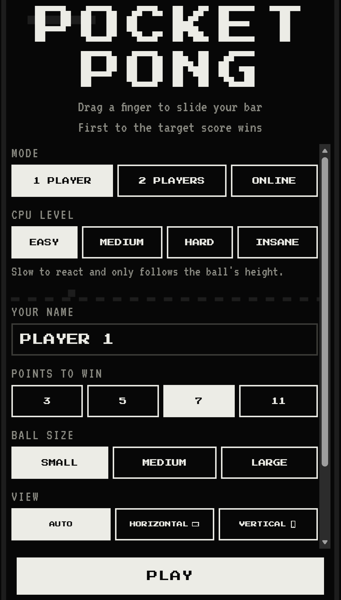

# Pocket Pong

Classic Pong for phones, tablets and computers. Plain HTML, CSS and JavaScript (no framework, no build dependencies to run it). 




## Layout

```
index.html              page markup (links src/ and the fonts)
src/styles.css          all styles
src/app.js              game, AI difficulty table, menu, sound, online mode
manifest.webmanifest    web-app manifest
scripts/build.js        builds www/ and dist/
scripts/serve.js        small local server for www/
capacitor.config.json   native app settings (app id, name, web folder)
tests/                  Playwright tests (npm test)
www/                    BUILT: what Capacitor / a static host serves
dist/                   BUILT: pocket-pong.single.html (one file), pocket-pong.artifact.html (Claude Artifact)
screenshots/            screenshots of the game
```

## Run it

```
npm install          # only needed for tests and the native apps
npm start            # builds, serves www/ on http://localhost:8080
npm test             # builds, then runs every test (about 90 checks)
```

Open `dist/pocket-pong.single.html` directly for a one-file copy you can send around.

## What differs by device

| | Phone / tablet (touch) | Computer (mouse, wide window) |
|---|---|---|
| Controls | drag a finger | mouse, W/S, arrow keys |
| View choice (Auto / Horizontal / Vertical) | yes | hidden: a monitor does not turn |
| Scanline overlay | off (saves battery, keeps small text sharp) | on, with a Retro screen On/Off option |
| Keyboard hints, fullscreen button | not shown | shown |
| Hotkeys | none | Enter play / resume / rematch, P or Esc pause, M sound, F fullscreen |

A computer is detected with `(hover: hover) and (pointer: fine) and (min-width: 900px)`; everything else gets the touch layout.

## iOS and Android apps (Capacitor)

Needs Node, plus Xcode (iOS, on a Mac) and Android Studio (Android).

```
npm install
npm run cap:add:ios        # once
npm run cap:add:android    # once
npm run cap:ios            # builds, syncs, opens Xcode
npm run cap:android        # builds, syncs, opens Android Studio
```

Before you ship:
- Fonts load from Google Fonts. For an app that must work offline, download Press Start 2P and VT323, put them in `src/fonts/`, and replace the Google link in `index.html` with `@font-face` rules in `src/styles.css`.
- Replace the app id in `capacitor.config.json` (`app.pocketpong.game`) with your own.
- Add app icons and a splash screen (`npx @capacitor/assets generate`).
- Online 2-player uses a Claude Artifact room feature. In a standalone or native build that feature is not present, so Online shows "not available" and the other modes work normally. A native build would need its own server (for example WebSockets) to replace it.

## Notes

- Settings are saved in `localStorage` under `pocket-pong`.
- The court is a fixed 1000 x 560 field scaled to the screen; difficulty levels live in the `DIFF` table in `src/app.js`.
- Online is still in progress.
- Working on android/ios build.
