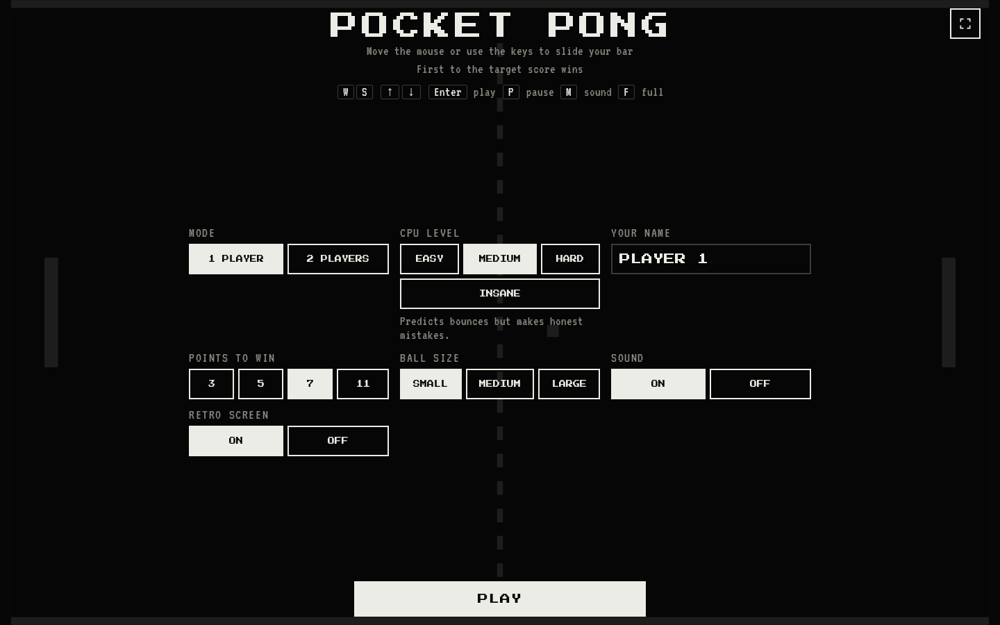

# 🎮 Pocket Pong

**Pocket Pong** is a fast, accessible arcade Pong game for phones, tablets, and computers. Players face a customizable CPU or a local opponent, control the paddles, and race to a selected target score.

🔗 **[Play the Game](https://jherogr.github.io/pocket-pong-game/)**

---

## ✨ Key Features
* **Core Mechanic:** Control a paddle to return the ball, build rallies, and win the first match to 3, 5, 7, or 11 points.
* **Modes and Difficulty:** Play solo against Easy, Medium, Hard, or Insane CPU levels, or compete locally in two-player mode.
* **Custom Match Settings:** Choose ball size, points to win, player names, horizontal or vertical view, and sound preferences.
* **Touch and Desktop Support:** Use touch, mouse, W/S or arrow keys, fullscreen, and retro scanline options.

---

## 🕹️ Controls

| Action | Keyboard / Mouse | Controller |
| :--- | :--- | :--- |
| **Move** | `W` `S` / Arrow Keys / Mouse or Touch | Not currently supported |
| **Start / Resume / Rematch** | `Enter` | Not currently supported |
| **Pause** | `P` / `Esc` | Not currently supported |
| **Toggle Sound** | `M` | Not currently supported |
| **Toggle Fullscreen** | `F` | Not currently supported |

---

## 🛠️ Built With
* **Engine / Framework:** Vanilla HTML, CSS, and JavaScript
* **Tool:** Claude
* **Art and Graphics:** HTML Canvas and custom pixel-style UI
* **Audio:** Browser-generated arcade sound
* **Language:** JavaScript
* **Native Packaging:** Capacitor
* **Testing:** Playwright

---

## 🤝 Credits & License
* **Developed by:** JHeroGR
* **Third-Party Assets:** Press Start 2P and VT323 Google Fonts
